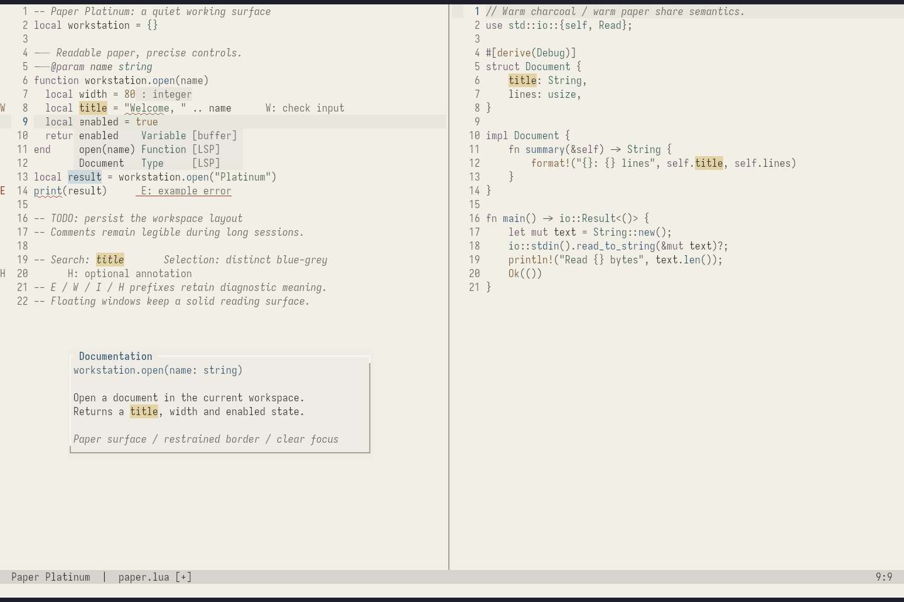
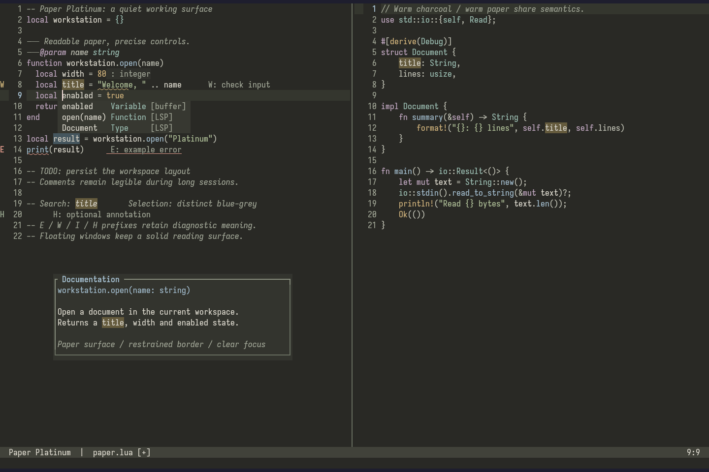

# Paper Platinum

[](https://github.com/RichardLitt/standard-readme)
[](https://www.conventionalcommits.org/en/v1.0.0/#specification)
[](./doc/README.gitflow.md)

[English](README.md) | [Chinese documentation](README.cn.md)

A reading-focused, true-color Neovim theme with warm paper and charcoal surfaces,
restrained syntax colors, and Platinum-inspired window structure.
Pure Lua, with no runtime dependencies, background tasks, or theme autocommands.

Targets **Neovim 0.11+**, tested on **0.12.4**. The 0.11 documentation has been checked, but that version has not been tested at runtime. Kitty works even when Neovim reports `t_Co=256`: the theme enables `termguicolors`, and Kitty renders the RGB colors. A terminal limited to 256 palette colors has no dedicated `cterm` fallback palette.

## Background

Light and Dark palettes are independently tuned, not inverted.
The theme combines clear semantic colors with grey-scale UI surfaces, restrained borders, and focused selection states.
See [DESIGN.md](doc/DESIGN.md) for the visual and semantic contract.

| Light | Dark |
| --- | --- |
|  |  |

These are real Kitty + Neovim TUI captures using Lua/Rust Tree-sitter, native completion, and diagnostic examples. [Language galleries](doc/TESTING.md#visual-inspection) show Rust, C/C++, Lua, Python, Shell, Markdown, JSON, YAML, and Diff.

### Referencing

The implementation is independently designed. Reference themes are cited for design research and optional vivid diagnostic accents; their implementations are not included. Verified API sources and compatibility notes are in [SOURCES.md](doc/SOURCES.md).

## Install

This checkout can be used locally before the project is published. From the repository root:

```sh
mkdir -p ~/.local/share/nvim/site/pack/themes/start
ln -s "$PWD" ~/.local/share/nvim/site/pack/themes/start/paper-platinum.nvim
```

For lazy.nvim, use a local plugin spec:

```lua
{
  dir = '/absolute/path/to/paper-platinum.nvim',
  name = 'paper-platinum.nvim',
  main = 'paper-platinum',
  lazy = false,
  priority = 1000,
  opts = { style = 'light' },
  config = function(_, opts)
    require('paper-platinum').setup(opts)
    vim.cmd.colorscheme('paper-platinum')
  end,
}
```

For LazyVim, create `lua/plugins/paper-platinum.lua`:

```lua
return {
  {
    dir = '/absolute/path/to/paper-platinum.nvim',
    name = 'paper-platinum.nvim',
    main = 'paper-platinum',
    lazy = false,
    priority = 1000,
    opts = {
      style = 'light',
      transparent = false,
      vivid = false,
      ui = { contrast = 'normal', relief = 'subtle' },
    },
  },
  { 'LazyVim/LazyVim', opts = { colorscheme = 'paper-platinum' } },
  {
    'nvim-lualine/lualine.nvim',
    optional = true,
    opts = { options = { theme = 'paper-platinum' } },
  },
}
```

Keep the LazyVim colorscheme setting in one place. Restart Neovim after editing theme source files to clear Lua module caches. The local `dir` can later be replaced with the repository URL.

## Structure

```text
colors/paper-platinum.lua             :colorscheme entry point
lua/paper-platinum/palette.lua         semantic Light/Dark palettes
lua/paper-platinum/config.lua          validated public options
lua/paper-platinum/highlights/         editor, syntax, Tree-sitter, LSP, diagnostics
lua/paper-platinum/integrations/       optional plugin highlight maps
lua/lualine/themes/                    lualine theme export
examples/init.lua                      full setup example
tests/                                 headless tests, fixtures, and capture scripts
doc/                                   help, design, sources, and test records
```

Integrations only define highlight groups; they do not `require()` optional plugins. Their supported scope and limits are documented in [Plugin support](#related-efforts).

## Usage

Minimal setup:

```lua
require('paper-platinum').setup({ style = 'dark' })
vim.cmd.colorscheme('paper-platinum')
```

`:colorscheme paper-platinum` works without `setup()` and defaults to opaque Dark. It enables `termguicolors` and sets `background`. It does not change Kitty settings, `winblend`, or `pumblend`.

Light with vivid diagnostics and transparent editor background:

```lua
require('paper-platinum').setup({
  style = 'light',
  transparent = true,
  vivid = true,
  ui = { contrast = 'high', relief = 'subtle' },
})
vim.cmd.colorscheme('paper-platinum')
```

`setup(opts)` saves options; `:colorscheme` applies them and fires `ColorScheme`. Each call merges with defaults, not the previous call. `load(opts)` applies immediately but does not emit `ColorScheme`. Use `setup()` followed by `:colorscheme` when plugins need that event to refresh. Changing `background` does not automatically change the selected style.

### Options

```lua
require('paper-platinum').setup({
  style = 'dark',                 -- light | dark
  transparent = false,
  vivid = false,
  terminal_colors = true,
  ui = {
    relief = 'subtle',            -- flat | subtle | classic
    contrast = 'normal',          -- normal | high
    borders = true,
    float_style = 'platinum',     -- platinum | plain
  },
  styles = {
    comments = { italic = true },
    keywords = { bold = false },
    functions = {},
    variables = {},
  },
  integrations = {
    treesitter = true, lsp = true, diagnostics = true,
    cmp = true, blink = true, telescope = true, fzf = true,
    nvim_tree = true, neo_tree = true, oil = true,
    gitsigns = true, diffview = true, which_key = true,
    lazy = true, mason = true, trouble = true, noice = true,
    notify = true, ibl = true, mini = true, snacks = true,
    flash = true, leap = true, render_markdown = true, bufferline = true,
  },
  -- on_colors = function(colors) end,
  -- on_highlights = function(highlights, colors) end,
})
```

`vivid = true` selects mode-aware diagnostic colors for both styles. Dark uses Tokyo Night's bright red `#f7768e` and yellow `#e0af68`; Light uses deeper red `#c02636` and gold `#8c5e00` for legibility. These colors reach diagnostic text, signs, underlines, floats, virtual text/lines, and groups linked to those semantics. Info/Hint and syntax colors remain restrained. Both pairs meet 4.5:1 on solid editor, float, and cursorline surfaces. Transparent wallpaper composition is not guaranteed.

`ui.contrast = 'high'` deepens body text and comments and strengthens borders independently of `vivid`. See [all options, color semantics, transparency, float borders, LSP priorities, and plugin support](README.cn.md) for the full reference in Chinese, or inspect the source-linked English notes in [DESIGN.md](doc/DESIGN.md), [SOURCES.md](doc/SOURCES.md), and [TESTING.md](doc/TESTING.md).

The Light block cursor uses vivid ultramarine (`#003fba`) with a light foreground, at 7.55:1 against the solid editor background. Contrast ratios have a maximum of 21:1, so 30–40:1 is not attainable with this metric.

For user highlight changes, `on_colors(colors)` runs before mappings and `on_highlights(highlights, colors)` runs last. Example:

```lua
require('paper-platinum').setup({
  on_colors = function(c) c.string = '#526d43' end,
  on_highlights = function(h, c)
    h.CursorLineNr = { fg = c.ochre, bold = true }
  end,
})
vim.cmd.colorscheme('paper-platinum')
```

Transparency is controlled by one option. `transparent = true` clears editor, float, sidebar, and popup menu surfaces; a table selects areas independently. `transparent = false` keeps every theme surface opaque:

```lua
require('paper-platinum').setup({
  style = 'light',
  transparent = {
    editor = true,
    floats = true,
    sidebars = true,
    popups = false,
  },
})
```

Table fields omitted or set to `false` remain opaque. The editor includes ordinary gutters; `sidebars` covers NvimTree, Neo-tree, and Trouble; `floats` covers `NormalFloat` and float borders; `popups` covers the completion menu and its border. Selected completion items keep their focus color. Kitty opacity, Neovim blending, and RGB backgrounds are separate mechanisms. The theme does not edit Kitty configuration.

For actual hover/diagnostic borders, pass `require('paper-platinum').border()` to the window API. Color highlights cannot add borders to windows by themselves. lualine has a separate theme interface: `require('lualine').setup({ options = { theme = 'paper-platinum' } })`.

### Options

The complete option reference and sample configuration are in [examples/init.lua](examples/init.lua) and [doc/paper-platinum.txt](doc/paper-platinum.txt).

## Plans

- Run the test suite on Neovim 0.11 in CI.
- Add interactive regression checks for the most widely used plugin windows.
- Recheck transparent composition against Kitty opacity and varied wallpapers.

Current completed checks and explicit limits are listed in [TESTING.md](doc/TESTING.md). The current environment verifies Neovim 0.12.4, not a 0.11 runtime.

## Related Efforts

| Integration | Supported highlight scope |
| --- | --- |
| nvim-cmp, blink.cmp | Menus, matches, kinds, documentation and signature windows |
| Telescope, fzf-lua | Main and preview windows, borders, titles, matches, selection |
| nvim-tree, neo-tree, Oil | Files, directories, Git states, selection |
| gitsigns, diffview | Git markers and diff panels |
| which-key, lazy.nvim, Mason, Trouble | Hints, management panels, diagnostic lists |
| Noice, nvim-notify | Command lines, messages and notifications |
| ibl, mini.nvim, Snacks.nvim | Indent guides and common UI modules |
| flash.nvim, Leap, render-markdown.nvim | Navigation and Markdown groups |
| bufferline.nvim, lualine.nvim | Bufferline groups and lualine theme export |

Mappings target verified public groups. Missing plugins do not cause errors. Plugin layouts, icon providers, external fzf colors, and forced plugin overrides may require plugin-specific configuration. See [SOURCES.md](doc/SOURCES.md) for upstream references and [TESTING.md](doc/TESTING.md) for verified behavior.

## Maintainers

[github@mujiu555](https://github.com/mujiu555)

## Contributing

You may inspect any part of the repository and open a pull request. When adding plugin groups, cite the upstream public names and include useful validation.

This repository follows [Conventional Commits v1.0.0](https://www.conventionalcommits.org/en/v1.0.0/#specification) and the [Git Flow branch convention](doc/README.gitflow.md). The commit requirements are documented in [doc/README.commit.md](doc/README.commit.md).

## License

Apache License, Version 2.0. See [LICENSE](LICENSE).
